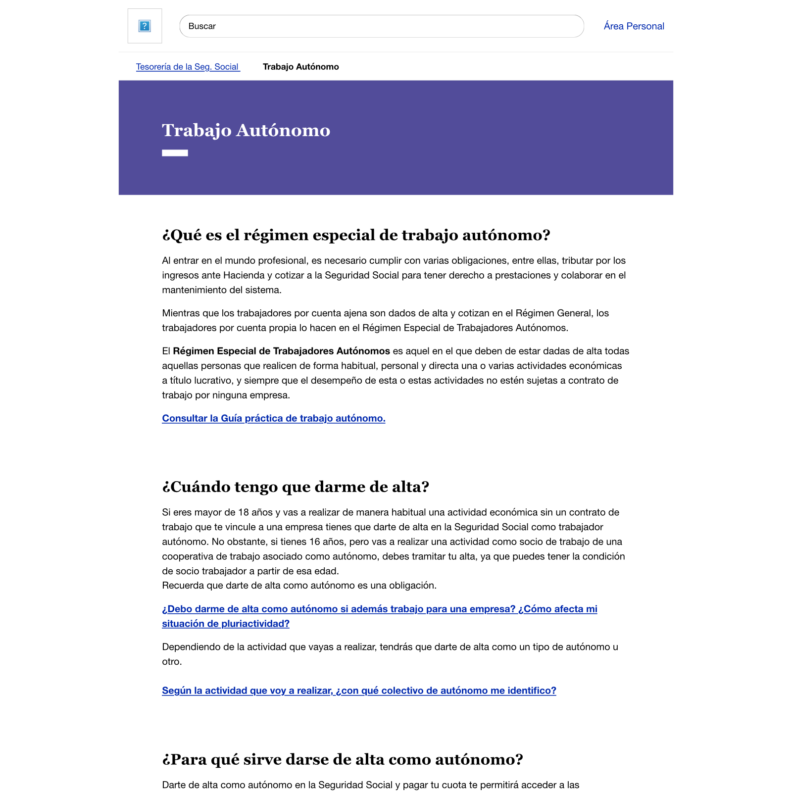
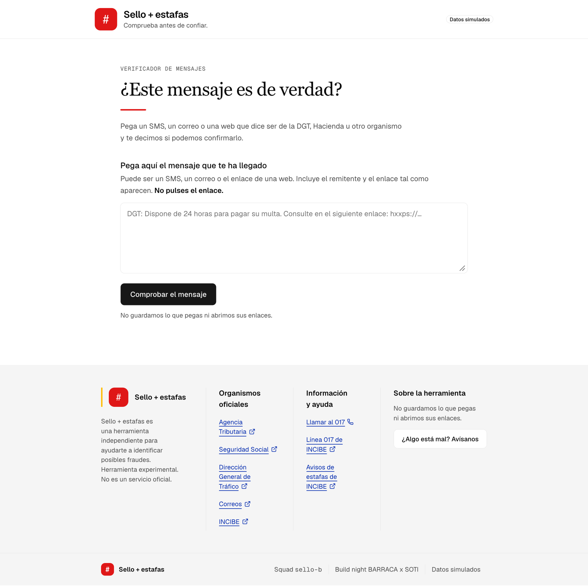

# Evidencia: ancho máximo como el portal Import@ss

Página de referencia: <https://portal.seg-social.gob.es/wps/portal/importass/importass/Colectivos/Trabajo+Autonomo>, consultada el 22/10/2026.

## Qué mide Import@ss

Reglas de la hoja de estilos de esa página (`/wps/contenthandler/importass/…/sp/mashup:ra:collection…`, `post_estilos_principales`):

| Bloque | Regla | Ancho |
| --- | --- | --- |
| Header | `.ss-header { max-width: 1024px; padding-left/right: 1rem }` | 1024 px |
| Contenedor general y pie | `.ss-wrapper { max-width: 1024px; padding: 0 1.5rem }`, `2rem` desde `45rem` | 1024 px |
| Cabecera de sección | `.ss-hero { max-width: 64rem }` | 1024 px |
| Texto de la página | `.ss-content { max-width: 58rem; padding: 0 1.5rem }`, `2rem` desde `45rem` | 928 px (864 px de texto) |

## Qué hace Sello B

| Bloque | Clases (`src/app/page.tsx`) | Ancho |
| --- | --- | --- |
| Header | `max-w-5xl px-4` | 1024 px (`max-w-5xl` = 64rem) |
| Pie | `max-w-5xl md:px-8` | 1024 px |
| Contenido | `max-w-[58rem] md:px-8` | 928 px (864 px de texto) |
| Contenido con `?casos-test` | `max-w-5xl md:px-8` | 1024 px, para que quepa el panel de ejemplos |

## Comparación con la misma ventana (~1440 px)

Renderizadas con la misma ventana simulada. En las dos, el header ocupa el mismo ancho y el texto arranca y termina en la misma columna.

| Import@ss | Sello B |
| --- | --- |
|  |  |

La captura de Import@ss se hizo sin sus scripts ni su logotipo (no se carga fuera del portal); solo sirve para comparar anchos.
